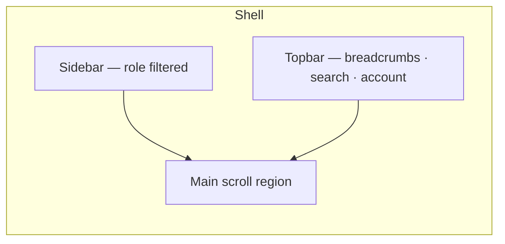
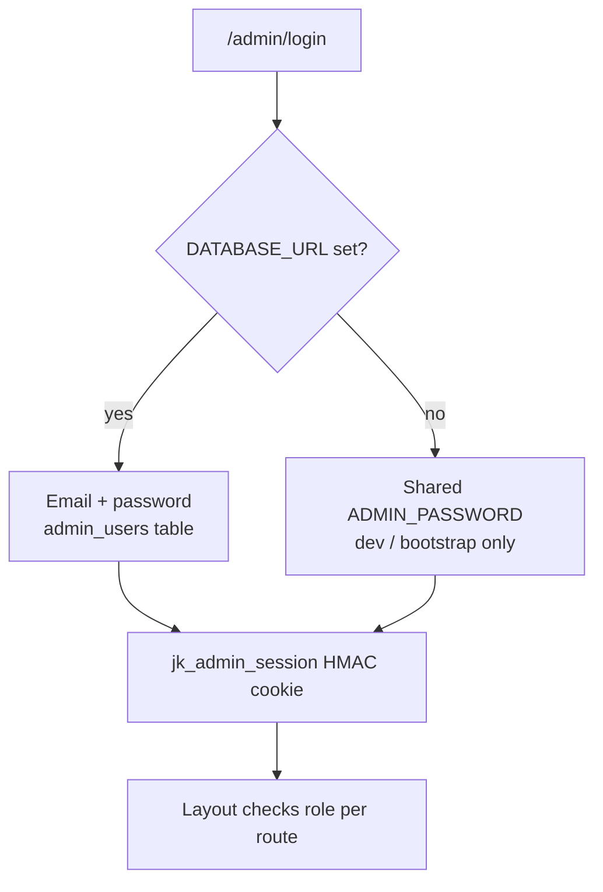
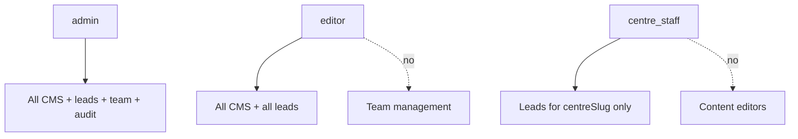
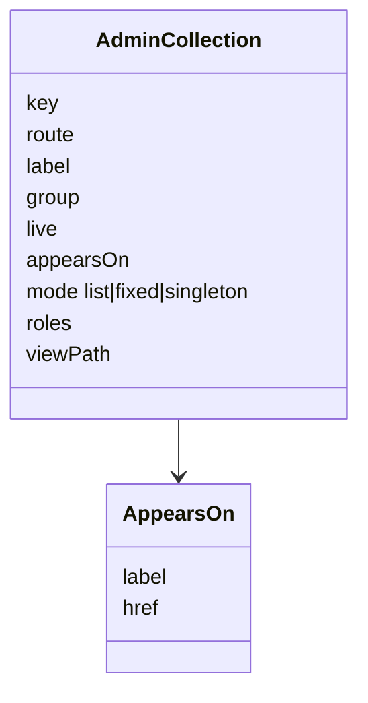
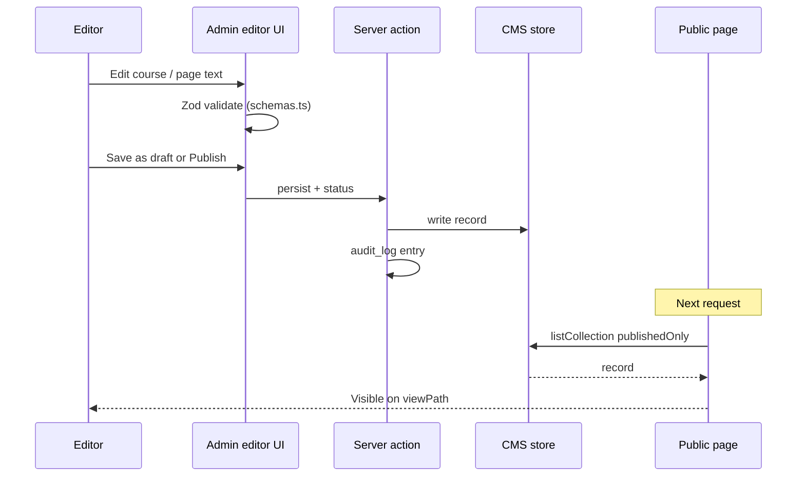
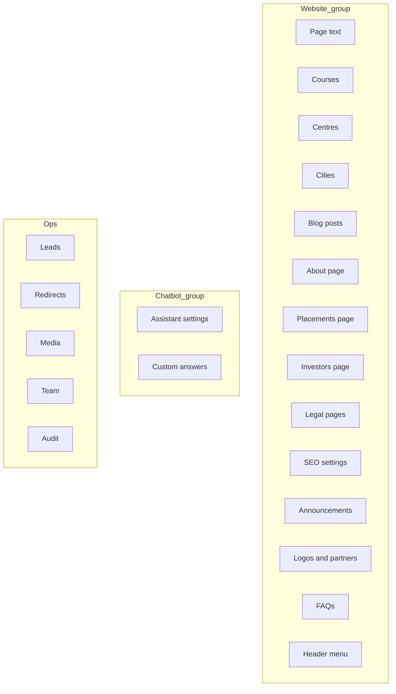
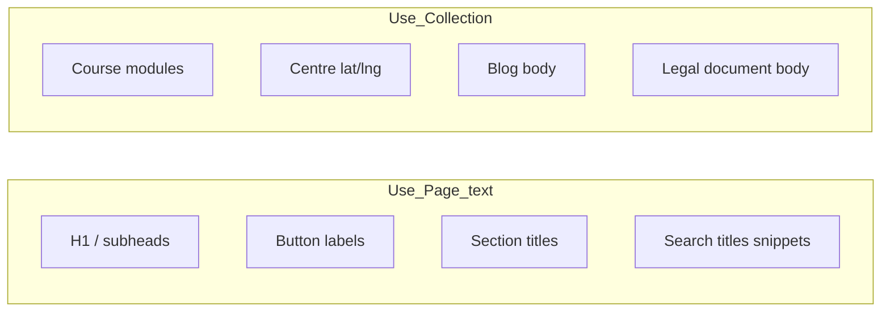
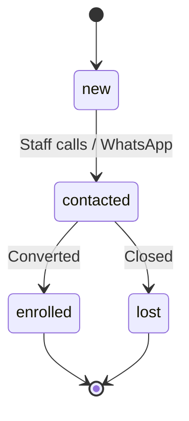
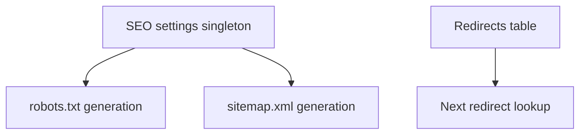

# Admin panel (CMS + CRM) — how it works

Staff work at **`/admin`**. The panel publishes website content, manages leads, tunes the chatbot, and controls SEO/redirects — with role-based access.

For UI density and component notes see also [ADMIN_PANEL.md](./ADMIN_PANEL.md).

---

## 1. Shell & navigation



| Area | Route prefix | Purpose |
| --- | --- | --- |
| Dashboard | `/admin` | Counts, shortcuts |
| Website map | `/admin/website` | Which CMS feeds which public URL |
| Content collections | `/admin/courses`, `/centres`, … | CRUD + publish |
| Page text | `/admin/page-text` | String overrides for marketing chrome |
| Leads | `/admin/leads` | CRM pipeline |
| Chatbot | `/admin/chatbot*` | Show on website, greeting, custom answers, console |
| SEO / redirects | `/admin/seo`, `/admin/redirects` | Indexing & 301s |
| Media | `/admin/media` | Uploads (DB-backed when configured) |
| Team | `/admin/team` | Users & roles (admin only) |
| Audit | `/admin/audit` | Who changed what |

Sidebar groups come from `registry.ts` (`GROUP.website`, `guide`, …). Persona rules are hidden. There is **no** Students / Parents / Professionals website section in the live IA (`/student`, `/parent`, `/professional` → `/`).

---

## 2. Authentication & roles

> Full visitor + staff auth (signup, OTP, cookies, secrets): **[AUTH.md](./AUTH.md)**.



Public site signup/login is **not** this flow — visitors use `/api/users/auth` and `jk_user_session`.

### Roles



| Role | Typical user |
| --- | --- |
| `admin` | IT / digital team lead |
| `editor` | Content / marketing |
| `centre_staff` | Branch counsellor (leads for one centre) |
| **Custom role** | Anything an admin defines under **Team & access → Roles** |

#### Custom roles

An admin can create roles of their own (for example "Content writer" or "Marketing"). A custom role is a
name, an optional description, and one level per section — **No access**, **View** or **View & edit**:

| Section | Covers |
| --- | --- |
| Website content | Courses, centres, blog, pages, FAQs, announcements, header menu and the other content editors (not the legal pages) |
| Leads | The enquiries inbox |
| Media library | Uploads |
| SEO | SEO overview and per-page settings |
| Redirects | URL redirects |
| Chatbot | Assistant settings, answers, policies, unanswered questions |

For Leads a role can also be limited to **one centre** (the member is then given a centre, like centre staff).
Team accounts, the audit log, the legal pages and "reset content" are **always admin-only** — no custom role can
grant them. Pages need *View*; anything that saves, uploads or deletes needs *View & edit* (checked on the server
for every action, and the sidebar hides sections a role cannot open and marks *View only* ones). Access is read
fresh on every request, so editing a role or moving someone to another role applies immediately. A role cannot be
deleted while people still have it. Stored in `custom_roles` (migration `0014`); a user whose role was removed
gets no access (deny by default).

Bootstrap first admin:

```bash
npm run db:migrate
npm run create:admin -- --name "Name" --email you@example.com --password "..."
```

Rotating `ADMIN_SESSION_SECRET` or bumping `sessionVersion` signs everyone out.

---

## 3. Collection model

Every editable content type is declared once in `src/app/(admin)/admin/registry.ts`.



| `mode` | Meaning | Examples |
| --- | --- | --- |
| `list` | Many records; add/delete | Courses, centres, posts |
| `singleton` | One document | About page, Placements page, SEO settings |
| `fixed` | Fixed set of docs | Some legal/settings shapes |

`live: false` means the website **does not** render that collection on a public page (it may only feed the chatbot). The editor shows a note so staff are not misled.

---

## 4. Edit → publish → live site



**Drafts never appear on the public site.** Preview from admin uses `viewPath` when published.

---

## 5. Module catalogue (what to edit for what)



### Quick “I want to change…” guide

| Goal | Open |
| --- | --- |
| Homepage headline / CTA label | **Page text** → Home |
| Flexible learning band on Courses | **Page text** → Courses — flexible learning |
| Families / “loves” band on About | **Page text** → About — families band |
| Course duration / modules / eligibility | **Courses** → that slug |
| Centre phone / address / gallery | **Centres** |
| City intro SEO | **Cities** |
| Placement disclaimer / process steps | **Placements page** |
| Leadership / timeline | **About page** |
| Top announcement bar | **Announcements** |
| Header menu links (add / remove / reorder) | **Header menu** |
| Footer wording and link text | **Page text** → Site |
| Partner logo strip | **Logos & partners** |
| robots / indexing policy | **SEO settings** |
| Old URL → new URL | **Redirects** |
| Show/hide Jetking AI site-wide (links + `/chatbot` + APIs) | **Assistant settings** → **Show on website** |
| Chatbot greeting / off-topic line | **Assistant settings** |
| Forced Q&A for chat | **Custom answers** |
| Follow up a phone enquiry | **Leads** |

---

## 6. Page text vs collections



Page text stores **flat string maps** per page id. Collections store **structured documents** validated by Zod in `src/lib/cms/schemas.ts`.

---

## 7. Leads CRM

Live leads are written to **both** the admin panel (`leads`) and the external CRM (`handoffLeadToCrm` in `src/lib/leads/crm-handoff.ts`). The panel row is saved first so a CRM outage never loses the enquiry.

If a panel lead is not yet `routed`, staff can **Push to CRM** from the lead detail, selection bar, or **Push unmatched to CRM** on the board. A successful save marks `routed`. If the API rejects the same mobile, status is `duplicate` but the row stays eligible for retry (each enquiry should be its own CRM entry). CLI: `npm run reconcile:crm-leads`.



```mermaid
flowchart TB
  In[Enquiry · Chat · Journey · Admin Add lead]
  Lead[(leads)]
  Act[(lead_activities)]
  UI[Leads table + detail drawer]
  Hand[handoffLeadToCrm]
  Ext[CRM_ENDPOINT]
  CRM[crmStatus: none|routed|skipped|failed|…]

  In --> Lead
  Lead --> Act
  Lead --> UI
  Lead --> Hand --> Ext
  Hand --> CRM
```

Centre staff only see rows where `centre_slug` matches their account. Admins/editors see all.

Fields include UTM, landing page, course interest, assigned counsellor, follow-up due date, and CRM hand-off status.

**Add lead** in the panel also triggers the same CRM hand-off. CSV **Import** stays panel-only.

---

## 8. Media library

When Postgres is configured, uploaded bytes live in the database so assets **survive redeploys** on any host (not only Vercel Blob). Admin → **Media** attaches URLs into course heroes, centre galleries, blog covers, etc.

---

## 9. Chatbot admin surfaces

| Screen | Function |
| --- | --- |
| `/admin/chatbot` | Ops console: Shown/Hidden status, model reachability, usage, recent chats |
| `/admin/chatbot-settings` | **Show on website** (site-wide on/off), greeting, starter chips, no-match / off-topic replies |
| `/admin/chatbot-knowledge` / custom answers | Curated Q→A overlays |
| `/admin/chatbot-questions` | Unanswered / review queue |

**Show on website** (`chatbot_settings.enabled`) is the single public switch: when off, every visitor entry point is hidden, `/chatbot` returns 404, and chat APIs refuse requests. Staff can still edit settings and knowledge. Full detail: [CHATBOT.md](./CHATBOT.md) · answer path: [DATA_FLOWS.md](./DATA_FLOWS.md).

---

## 10. SEO & redirects from admin



Editors can add a 301 without a code deploy. Verify with:

```bash
npm run verify:seo -- --base https://www.jetking.com
```

---

## 11. Permissions matrix (summary)

| Capability | admin | editor | centre_staff |
| --- | --- | --- | --- |
| Edit courses / centres / pages | ✓ | ✓ | — |
| Publish / unpublish | ✓ | ✓ | — |
| All leads | ✓ | ✓ | own centre |
| Team & access | ✓ | — | — |
| Audit log | ✓ | limited / ✓* | — |
| SEO / redirects | ✓ | ✓ | — |
| Chatbot settings | ✓ | ✓ | — |
| Custom role | per section: none / view / edit — never team, audit, legal pages |

\*Exact audit visibility follows route `roles` in registry — admins always full.

---

## 12. Local vs production admin

| | Local (no DB) | Production (with DB) |
| --- | --- | --- |
| Login | Shared `ADMIN_PASSWORD` / `changeme` | Per-user email+password |
| Content | `data/cms/store.json` + fixtures | Postgres CMS tables |
| Leads | Limited / logged | Full CRM |
| Team page | N/A | Invite staff, create custom roles; welcome emails when `MAIL_*` is set |

See [SHARED_DATABASE.md](./SHARED_DATABASE.md).

---

## 13. Related

- [ARCHITECTURE.md](./ARCHITECTURE.md)
- [AUTH.md](./AUTH.md) — staff + visitor login
- [PUBLIC_WEBSITE.md](./PUBLIC_WEBSITE.md)
- [ADMIN_PANEL.md](./ADMIN_PANEL.md) — visual / UX detail
- [DEPLOYMENT_RUNBOOK.md](./DEPLOYMENT_RUNBOOK.md)
