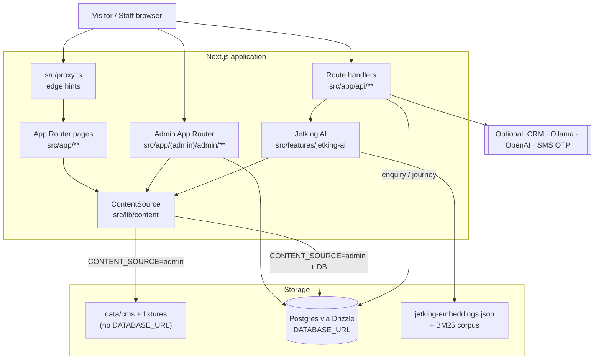
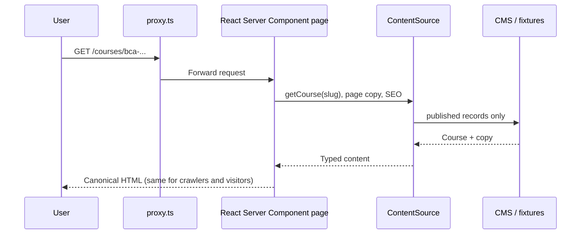
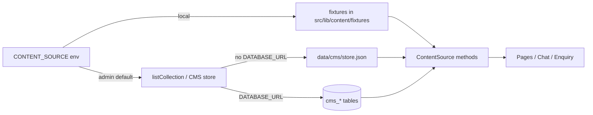
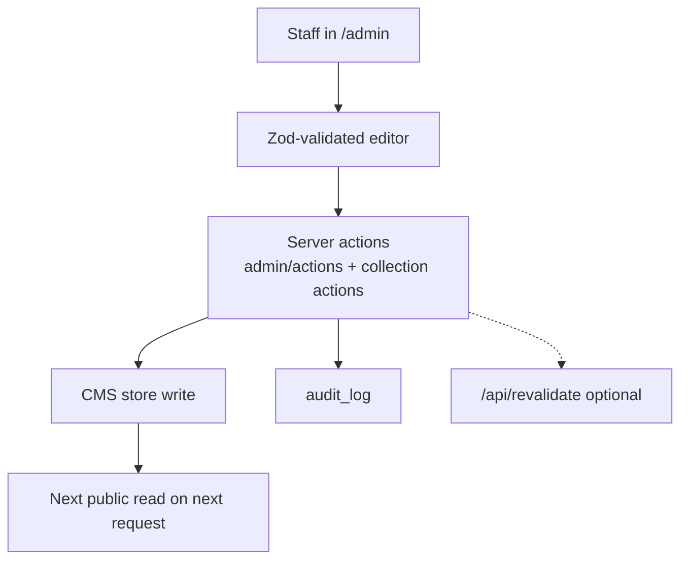
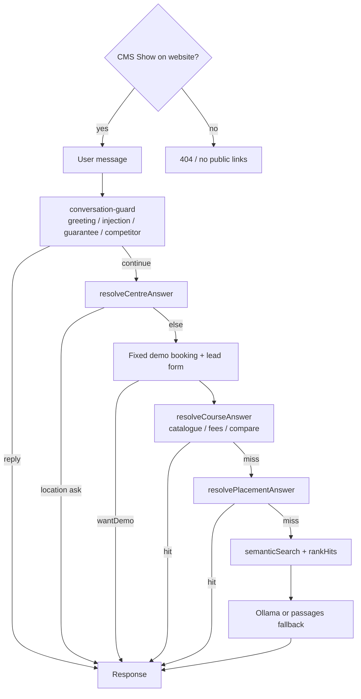
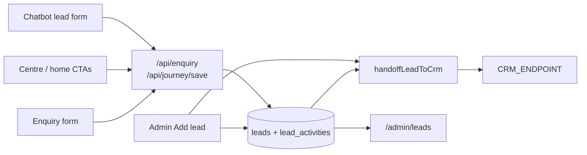
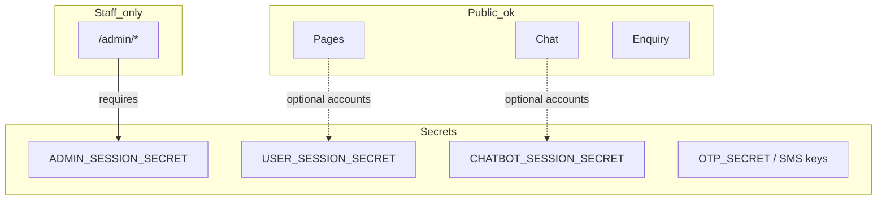

# System architecture

## 1. What this platform is

A **single Next.js 16 App Router** project that includes:

| Surface | URL | Who uses it |
| --- | --- | --- |
| Marketing / career website | `/`, `/courses`, `/centres`, … | Public visitors |
| Staff CMS + CRM | `/admin` | Admins, editors, centre staff |
| Jetking AI assistant | `/chatbot` (CMS **Show on website**; otherwise 404) | Public visitors |
| Public APIs | `/api/*` | Enquiry, chat, auth, OTP, revalidate |

There is **one codebase, one deploy**. Content is not cloned into a separate headless CMS product — the admin panel *is* the CMS.

---

## 2. High-level architecture



---

## 3. Technology stack

| Concern | Choice |
| --- | --- |
| Framework | Next.js 16 (App Router), React 19, TypeScript |
| Styling | Tailwind CSS v4 + Jetking design tokens (`src/styles`) |
| Public content API | `ContentSource` (`local` fixtures **or** `admin` CMS) |
| CMS persistence | File store under `data/cms/` **or** Postgres collections |
| Leads / staff / OTP / media bytes | Postgres + Drizzle (`src/lib/db/schema.ts`) |
| Chatbot retrieval | Local embeddings (`@xenova/transformers`) + BM25 |
| Chatbot wording | Ollama by default (`GUIDE_PROVIDER=local`); OpenAI opt-in |
| Auth (admin) | Signed cookie `jk_admin_session` |
| Auth (site / chatbot) | Separate cookies: `jk_user_session`, `jk_chat_session` |
| Audience paths (student/parent/professional) | **Removed from IA** — URLs 301 to `/` |
| Hosting | Vercel (primary) or Node standalone (`BUILD_STANDALONE=true`) |

---

## 4. Request lifecycle (public page)



**SEO rule:** one canonical HTML document per URL (no cloaking). The site does **not** ship separate student/parent/professional experiences; old paths redirect home.

---

## 5. ContentSource — single read API

All public pages and many chatbot resolvers call `content.*` from `src/lib/content`.



| Method examples | Used by |
| --- | --- |
| `listCourses()`, `getCourse(slug)` | `/courses`, centre featured, chatbot course answers |
| `listCentres()`, `getCity()` | `/centres`, maps, enquiry centre pickers |
| `getPlacementsPage()` | `/placements`, chatbot placement answers |
| `getPageCopyOverrides(id)` | Headings/CTAs editable in **Page text** |
| `getSeoSettings()` | `robots.ts`, sitemap behaviour |

Draft records are **never** returned to the public site (`publishedOnly: true`).

---

## 6. Admin write path



Publish semantics: each collection row has a `status` (`draft` | `published`). Only published rows appear on the website.

---

## 7. Chatbot answer pipeline

Public availability is CMS-managed: **Admin → Assistant settings → Show on website** (`chatbot_settings.enabled`). When off, `/chatbot` and `/api/chat` are unavailable (404) and all public links stay hidden — see [CHATBOT.md](./CHATBOT.md).



Structured resolvers use the **same catalogue / placements content** as the website so fees, eligibility, and “100% placement” SEO blobs cannot invent facts.

Default model policy: `GUIDE_PROVIDER=local` — **no OpenAI required**. See [CHATBOT.md](./CHATBOT.md).

---

## 8. Leads & enquiry

Live paths dual-write: **admin `leads` table first**, then shared [`src/lib/leads/crm-handoff.ts`](../src/lib/leads/crm-handoff.ts) to the external CRM.



Without `DATABASE_URL`, enquiries cannot be stored in the panel (logged only). Production should set Postgres **and** `CRM_ENDPOINT` (plus `CRM_PROVIDER=smartrain` when using Smartrain).

---

## 9. Security boundaries



| Role | Access |
| --- | --- |
| `admin` | Full CMS, leads, team, audit |
| `editor` | Content + all leads; no team management |
| `centre_staff` | Leads for assigned `centreSlug` only |

Production refuses to boot with default admin passwords / missing session secrets.

---

## 10. Key directories

```
src/
├── app/                    # Routes: public, (admin), api
├── components/             # Marketing UI
├── features/jetking-ai/    # Chat orchestration + resolvers
├── features/knowledge/     # Embeddings / index
├── lib/content/            # ContentSource, fixtures, copy
├── lib/cms/                # Admin store, schemas
├── lib/db/                 # Drizzle schema
├── lib/auth/               # Admin sessions & roles
├── persona/                # Legacy helpers only — not a live product feature
└── styles/                 # Design tokens
drizzle/migrations/         # Postgres migrations
data/cms/                   # File-backed CMS when no DB
docs/                       # This documentation set
```

---

## 11. Related docs

- [PUBLIC_WEBSITE.md](./PUBLIC_WEBSITE.md) — page map and rendering
- [ADMIN_CMS.md](./ADMIN_CMS.md) — staff workflows
- [DATA_FLOWS.md](./DATA_FLOWS.md) — end-to-end data
- [DEPLOYMENT_RUNBOOK.md](./DEPLOYMENT_RUNBOOK.md) — hosting
