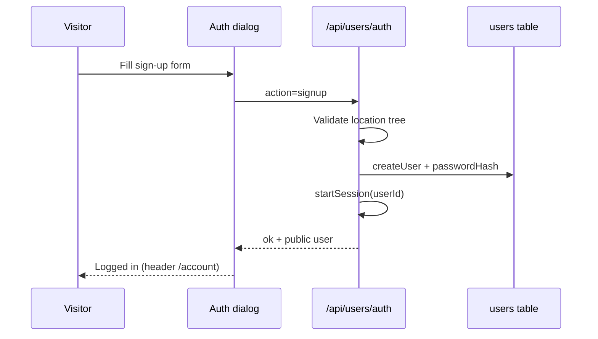
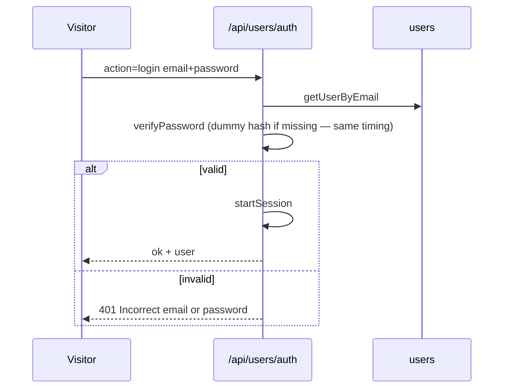

# Login & signup — how it works

There are **two separate account systems**. Staff and visitors never share credentials or cookies.

| System | Who | Entry points | API / page | Cookie | Table |
| --- | --- | --- | --- | --- | --- |
| **Visitor accounts** | Public visitors | Header, `/account`, enquiry, `/chatbot` | `POST /api/users/auth` | `jk_user_session` | `users` |
| **Admin (staff)** | Jetking staff | `/admin/login` | Server actions in `admin/actions.ts` | `jk_admin_session` | `admin_users` |

---

## 1. Overview diagram

```mermaid
flowchart TB
  subgraph Visitors
    Header[Site header Login]
    Acc[/account]
    Chat[/chatbot]
    Enq[Enquiry form]
    Dialog[SiteAuthDialog / Chat AuthDialog]
    API["/api/users/auth"]
    U[(users)]
    SU[jk_user_session]
  end

  subgraph Staff
    AL[/admin/login]
    AA[admin login action]
    AU[(admin_users)]
    AS[jk_admin_session]
  end

  Header --> Dialog
  Acc --> Dialog
  Chat --> Dialog
  Enq --> Dialog
  Dialog --> API --> U
  API --> SU
  SU --> Acc
  SU --> Chat

  AL --> AA --> AU
  AA --> AS
  AS --> AdminUI[/admin CMS]
```

---

## 2. Visitor accounts (website + chatbot)

**One register/login covers the public website and Jetking AI** (when the assistant is shown).  
`/api/chatbot/auth` re-exports the same handlers as `/api/users/auth` (migration `0013_unify_visitor_accounts`).

Jetking AI itself can be turned off site-wide in **Admin → Assistant settings → Show on website**. Accounts still work for the website and `/account`; chat UI and saved-chat APIs are unavailable while the assistant is hidden.

### UI

| Surface | Component |
| --- | --- |
| Main site | `SiteAuthDialog` (`src/components/account/SiteAuthDialog.tsx`) |
| Chatbot | Auth dialog under `src/features/jetking-ai/account/` (only when Show on website is on) |
| Client hook | `use-site-account.ts` / `use-chat-account.ts` |

Modes in the dialog: **Login** · **Sign up** · **Reset password**.  
Login methods: **email + password** or **mobile OTP**.

### Sign up

Required fields:

| Field | Rules |
| --- | --- |
| Name | 2–80 characters |
| Email | Valid, unique |
| Phone | 10–15 digits (normalised) |
| Password | Min 8 characters (PBKDF2 hash stored) |
| State + city | Must match Jetking location lists |
| Centre | Optional; must match city if set |

Flow:



Duplicate email → `409` with “Try logging in instead.”  
Rate limit: **10 signups / hour** per client.

### Login — email + password



Rate limit: **10 attempts / 10 minutes**.

### Login — mobile OTP

1. `login_otp_send` — resolve account(s) by phone; send SMS OTP when exactly one match (or after email disambiguation).
2. If several accounts share the number → `needsEmail: true`.
3. `login_otp_verify` — prove OTP (`otpToken` or `code`) → `startSession`.

Requires OTP/SMS config (`OTP_ENABLED`, `SMS_*`, `OTP_SECRET`) for real SMS. In dev, codes may be echoed when `OTP_DEV_ECHO=true`.

### Forgot / reset password

Two ways, either or both can be on:

**By email link** (needs `MAIL_*` and `NEXT_PUBLIC_EMAIL_RESET_ENABLED=true`)

1. `reset_email_send` — email only. If an account exists, a link `/account/reset-password?token=…` is emailed.
2. The visitor opens the link, enters a new password (min 8), and `reset_email_confirm` updates the hash and signs them in.

The token is signed (HMAC with `USER_SESSION_SECRET`, domain-separated), expires after 30 minutes, and carries a
fingerprint of the current password hash — so it works **once** and stops working the moment the password changes.
No table is needed. The answer to the request is identical whether or not the email has an account, the email is
sent after the response (no timing difference), each mailbox is limited to 3 requests per hour, and the page sends
`Referrer-Policy: no-referrer` so the token never leaks.

**By SMS code** (needs OTP configured)

1. `reset_send` — email and/or phone; OTP goes to the mobile on the account.
2. `reset_verify` — OTP proof + `newPassword` (min 8) → update hash → can sign in again.

Unknown emails still return a generic success shape (no account enumeration). "Forgot password?" is shown when
at least one of the two ways is enabled.

### Logout & “who am I”

| Method | Behaviour |
| --- | --- |
| `GET /api/users/auth` | Current user from cookie (or anonymous) |
| `DELETE /api/users/auth` | Clears `jk_user_session` (+ legacy `jk_chat_session`) |

### Session cookie

| Property | Value |
| --- | --- |
| Name | `jk_user_session` |
| Secret | `USER_SESSION_SECRET` (**required in production**) |
| Lifetime | 30 days |
| Flags | `httpOnly`, `sameSite=lax`, `secure` in production |
| Payload | `userId.issuedAt.signature` (HMAC) — no password |

Hint cookie `jk_user_hint` is script-readable only to skip “who am I” for anonymous visitors; the server never trusts it for identity.

### Storage

| Env | Backend |
| --- | --- |
| `DATABASE_URL` set | Postgres `users` (+ `chat_conversations` for saved chats) |
| No DB | File-backed store under the users store (dev / limited) |

Password hashing: shared `src/lib/auth/password.ts` (PBKDF2) — same algorithm as admin, **different tables**.

### What login unlocks

- `/account` profile
- Saved chatbot conversations (only when Assistant settings → Show on website is on)
- Prefill / recognition on enquiry when signed in

---

## 3. Admin (staff) login

**Not** available from the public header. Only `/admin/login`.

```mermaid
flowchart TB
  Login[/admin/login]
  Mode{DATABASE_URL?}
  Multi[Email + password<br/>admin_users]
  Legacy[Shared ADMIN_PASSWORD]
  Cookie[jk_admin_session]
  Gate[Role-gated /admin routes]

  Login --> Mode
  Mode -->|yes| Multi --> Cookie
  Mode -->|no| Legacy --> Cookie
  Cookie --> Gate
```

| Role | Access |
| --- | --- |
| `admin` | Full CMS, leads, team, audit |
| `editor` | Content + all leads; no team management |
| `centre_staff` | Leads for their `centreSlug` only |
| custom role | Whatever an admin ticked per section (never team / audit / legal pages) — see [ADMIN_CMS.md](./ADMIN_CMS.md) |

Staff emails: when `MAIL_*` is configured, creating a team member emails them a welcome message (sign-in link, their email, the temporary password the admin chose), and an admin password reset emails the new temporary password. The admin sees whether the email was sent; if email is off they share the password directly. Members should change it under **My account**.

Bootstrap first admin (with DB):

```bash
npm run db:migrate
npm run create:admin -- --name "Name" --email you@example.com --password "..."
```

| Cookie | `jk_admin_session` |
| Secret | `ADMIN_SESSION_SECRET` |
| Rate limit | ~8 attempts / 10 minutes |

Rotating `ADMIN_SESSION_SECRET` or bumping `sessionVersion` on a user signs them out everywhere. Changing password also bumps `sessionVersion`.

---

## 4. Secrets checklist

| Variable | Used for |
| --- | --- |
| `USER_SESSION_SECRET` | Visitor `jk_user_session` |
| `ADMIN_SESSION_SECRET` | Staff `jk_admin_session` |
| `CHATBOT_SESSION_SECRET` | Legacy / related chat paths (unified visitors use `USER_SESSION_SECRET`) |
| `OTP_SECRET` | OTP tokens when mobile login / enquiry OTP is on |
| `SMS_*` | SMS gateway for OTP |
| `MAIL_*` | SMTP for staff and visitor password emails (use an App Password for Gmail) |

Never reuse the admin password as a visitor account. Never commit secrets.

---

## 5. Related code

| Path | Role |
| --- | --- |
| `src/app/api/users/auth/route.ts` | Visitor signup / login / OTP / reset |
| `src/app/api/chatbot/auth/route.ts` | Re-exports visitor auth |
| `src/lib/users/session.ts` | Visitor cookie |
| `src/lib/users/store.ts` | `users` persistence |
| `src/lib/users/reset-token.ts` | Single-use email reset token |
| `src/lib/mail/` | SMTP sender and email templates |
| `src/app/account/reset-password/` | Page the reset link opens |
| `src/lib/auth/roles.ts`, `custom-roles.ts` | Built-in presets, sections, custom roles |
| `src/components/account/SiteAuthDialog.tsx` | Website dialog |
| `src/app/(admin)/admin/actions.ts` | Staff login / logout |
| `src/lib/auth/session.ts` | Admin cookie |
| `src/lib/db/schema.ts` | `users`, `admin_users`, `chat_conversations` |

---

## 6. Related docs

- [INDEX.md](./INDEX.md)
- [ADMIN_CMS.md](./ADMIN_CMS.md) — roles after staff login
- [DATA_FLOWS.md](./DATA_FLOWS.md) — cookies & leads
- [DEPLOYMENT_RUNBOOK.md](./DEPLOYMENT_RUNBOOK.md) — env vars for production
