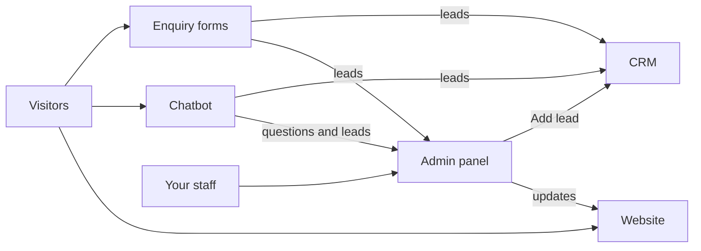
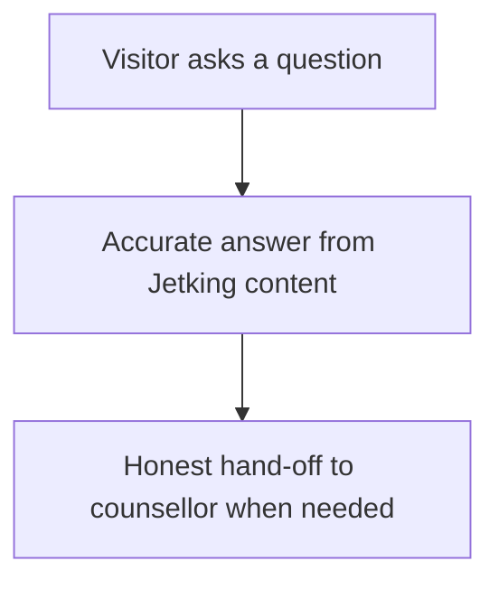
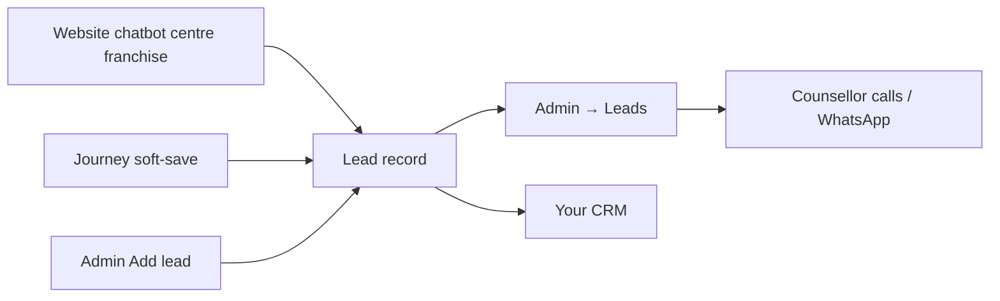
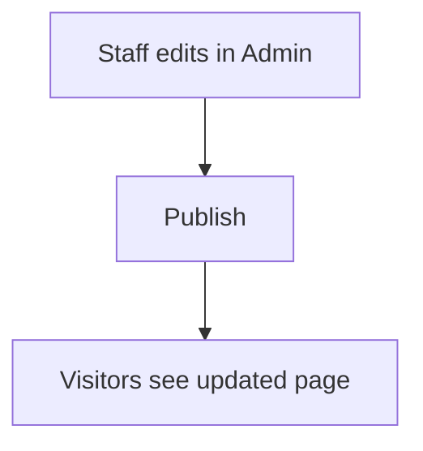

# Jetking Website Platform — Client Guide

**Audience:** Jetking leadership, marketing, centre managers, and operations  
**Purpose:** Explain what the new website does, how your team uses it, and what visitors experience — without technical jargon.

---

## 1. What you are getting

One modern platform that includes:

| Part | What it is | Who uses it |
| --- | --- | --- |
| **Public website** | Courses, centres, placements, blog, enquiry, franchise, about, investors | Anyone exploring Jetking training |
| **Admin panel** | Easy control panel to update content and follow leads | Your staff |
| **Jetking AI chatbot** | Answers questions about courses, fees, centres, placements | Website visitors |
| **Visitor accounts** | Optional login so people can save chats and return later | Visitors who choose to register |

Every enquiry (website forms, chatbot, centre pages, admin “Add lead”, journey soft-save) is stored in the **admin Leads board** and also handed to your **CRM** when `CRM_ENDPOINT` is configured. If the CRM is down or the lead is incomplete for that CRM, the admin panel still keeps the record.

Everything stays under **your brand** (Jetking), on **your domain** when you go live.

---

## 2. What visitors see on the website

### Main sections

| Page | Purpose |
| --- | --- |
| **Home** | Brand story, programmes highlight, centres, calls to action |
| **Courses** | Full catalogue + each course detail (duration, eligibility, what you learn) |
| **Centres** | Find a city and centre — address, phone, what is taught there |
| **Placements** | How placement support works, partners, success stories |
| **About** | Company story and leadership |
| **Blog / FAQ** | Articles and common questions |
| **Enquiry** | “Talk to us” form |
| **Franchise** | Partner / franchise interest |
| **Explore** | Optional “why Jetking” landing |
| **Investors / Legal** | Disclosures, privacy, terms |
| **Chatbot** | Ask Jetking AI in plain language (English or Hinglish) |

There are **no separate “For students / For parents / For professionals” sections** on the live site. Those old URLs redirect to the home page. Everyone sees the same Jetking website.

### What visitors can do

1. Browse courses and centres  
2. Ask the chatbot for guidance  
3. Submit an enquiry (name, phone, course interest, city/centre)  
4. Optionally **create an account** (email or mobile) to save chatbot chats and return later  
5. Call or WhatsApp using the numbers you configure  

### Important honesty rules (built in)

- **Fees** are not shown as a single public price — visitors are told fees vary by centre and intake and a counsellor confirms the amount.  
- **Placements** are described as **support** (resume, mock interviews, introductions) — **not** a guaranteed job.  
- The chatbot is trained to stay with **Jetking facts** and not invent competitors’ claims or fake fee numbers.

---

## 3. Jetking AI chatbot (visitor experience)

Visitors open **Chat** / `/chatbot` and can ask things like:

- “What courses do you offer?”  
- “Cloud computing courses after 12th”  
- “Difference between BCA and MCA”  
- “Ethical hacking course duration / eligibility”  
- “Fees and EMI?”  
- “Nearest centre in Pune?”  
- “Do you guarantee placement?”  

**How answers stay accurate**

- Course lists, duration, eligibility → from your **published course catalogue**  
- Centres → from your **centre directory**  
- Placements → from your **placements page** wording  
- Fees → counsellor message (no invented ₹ amounts)  

**No OpenAI required** for go-live: answers work from your website content (and optional local AI for smoother wording later).

---

## 4. Visitor login & signup (optional)

Visitors do **not** need an account to browse or enquire.  
If they sign up, **one account** works for both the website and the chatbot.

| Action | What they provide |
| --- | --- |
| **Sign up** | Name, email, mobile, password, state, city (centre optional) |
| **Log in** | Email + password **or** mobile OTP |
| **Forgot password** | OTP to their registered mobile, then new password |

After login they can use **/account** and see **saved chatbot conversations**.

> Staff admin login is completely separate (see §6). A visitor cannot access the admin panel with a website account.

---

## 5. Enquiries & leads (sales pipeline)

Whenever someone submits a form (home, course, centre, enquiry page, franchise, chatbot lead form), uses the student-journey soft save, or a counsellor clicks **Add lead** in admin, a **lead** is created.

**Every live lead goes to both places:**

1. **Admin → Leads** (your panel always keeps a copy)  
2. **Your CRM** (when `CRM_ENDPOINT` is configured)

If the CRM is down or the lead is incomplete for that CRM (e.g. Smartrain needs email + a mapped centre), the admin panel still keeps the record so nothing is lost.

**What staff can see on each lead (typical)**

- Name, phone, email  
- Course interest and centre/city  
- Where the enquiry came from (page / chatbot / admin)  
- CRM hand-off status (routed / skipped / failed)  
- Status: new → contacted → enrolled / lost  
- Notes, follow-up date, assigned counsellor  

Centre staff can be limited to **only their centre’s leads**. Bulk CSV **Import** stays admin-panel only (so historical imports do not flood the CRM).

---

## 6. Admin panel — your team’s control centre

**Address:** `/admin` (after go-live: `https://www.jetking.com/admin`)

### Who can sign in

| Role | Typical person | What they can do |
| --- | --- | --- |
| **Admin** | Digital / IT lead | Everything: content, leads, team access, audit |
| **Editor** | Marketing / content | Update website content and all leads |
| **Centre staff** | Branch counsellor | Leads for their centre only |

### What you can update without calling developers

| In admin | Changes on the live site |
| --- | --- |
| **Page text** | Headlines, button labels, short marketing lines (includes **Courses — flexible learning** and **About — families band**) |
| **Courses** | Titles, duration, eligibility, modules, SEO text |
| **Centres / Cities** | Address, phone, gallery, city intros |
| **Blog posts** | Articles |
| **Placements page** | Process steps, disclaimer, partner messaging |
| **About page** | Leadership and company story |
| **Announcements** | Top bar message sitewide |
| **Logos & partners** | Partner strips |
| **FAQs** | FAQ answers |
| **SEO settings** | Indexing / sitemap behaviour |
| **Redirects** | Old URL → new URL (important for SEO migration) |
| **Legal pages** | Privacy, terms, enrollment terms |
| **Chatbot settings** | Greeting and “can’t answer” message |
| **Leads** | Follow up every enquiry |
| **Team** | Invite editors and centre staff (Admin only) |
| **Media** | Upload images used on pages |

**Draft vs Publish:** you can save a draft and publish when ready. Drafts are not shown to the public.

---

## 7. How content stays consistent

The **same course and centre information** powers:

- Public course / centre pages  
- Enquiry dropdowns  
- Chatbot accurate answers  

So when marketing updates a course in Admin and publishes it, the website and chatbot stay aligned.

---

## 8. Going live (business view)

Today’s public site (`www.jetking.com`) is still on the **old host**.  
This new platform is ready to replace it when you approve cutover.

| Step | What happens | Who |
| --- | --- | --- |
| 1 | Hosting + secure database set up | Technical team |
| 2 | Your content reviewed and published in Admin | Marketing |
| 3 | Real phone, WhatsApp, CRM connected | Ops / sales |
| 4 | Staff accounts created; training on Admin + Leads | Admin + centres |
| 5 | Test on a private preview URL | All stakeholders |
| 6 | Domain pointed to the new site | Technical + leadership approval |
| 7 | Old URLs redirected; Google sitemap submitted | SEO / technical |

**Rollback:** if anything critical fails, DNS can be pointed back to the previous site quickly.

---

## 9. What your team should decide before launch

Use this as a checklist in stakeholder meetings:

- [ ] Final phone and WhatsApp numbers for the site  
- [ ] Who receives and assigns leads daily  
- [ ] Whether enquiries also go into your existing CRM  
- [ ] Which staff get Admin / Editor / Centre staff access  
- [ ] Course and centre content signed off as correct  
- [ ] Placement wording approved (no “100% guarantee” language)  
- [ ] Fee messaging approved (counsellor confirms; no fake prices)  
- [ ] Legal pages (privacy / terms) signed off  
- [ ] Go-live date and who can approve DNS cutover  

---

## 10. Benefits summary

| For visitors | For Jetking |
| --- | --- |
| Clear courses & centres | Update content yourselves in Admin |
| Honest chatbot answers | Leads in one place with follow-up |
| Easy enquiry | Roles so centres only see their leads |
| Optional account + saved chats | SEO-ready pages and redirects from the old site |
| Mobile-friendly site | One platform: website + chatbot + CRM light |

---

## 11. Where to get deeper (internal / technical) detail

If your technical partner needs implementation depth:

| Document | Topic |
| --- | --- |
| [INDEX.md](./INDEX.md) | Full documentation index |
| [PUBLIC_WEBSITE.md](./PUBLIC_WEBSITE.md) | Page structure |
| [ADMIN_CMS.md](./ADMIN_CMS.md) | Admin modules in depth |
| [AUTH.md](./AUTH.md) | Login / signup mechanics |
| [CHATBOT.md](./CHATBOT.md) | How Jetking AI answers |
| [DEPLOYMENT_RUNBOOK.md](./DEPLOYMENT_RUNBOOK.md) | Hosting and go-live steps |

---

## 12. Support model (suggested)

| Need | Contact |
| --- | --- |
| Content wrong on a page | Editor updates in Admin → Publish |
| Lead not showing | Check Admin → Leads; confirm form was submitted |
| New staff member | Admin → Team & Access |
| Domain / outage / deploy | Technical hosting owner |
| CRM not receiving leads | Technical + CRM vendor |

*(Fill in real names/phones for Jetking when you hand this pack to the client.)*

---

*This guide describes the Jetking unified website platform as built for Jetking Infotrain. It is intended for non-technical stakeholders.*
