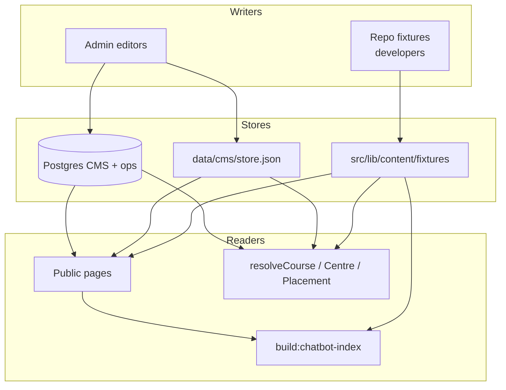
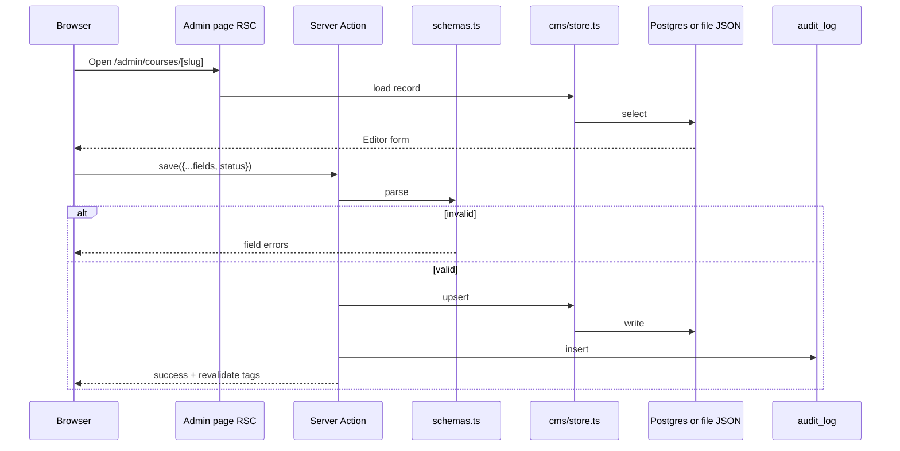
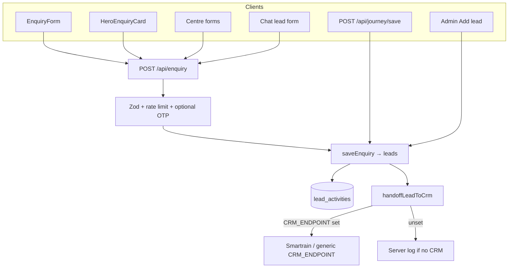
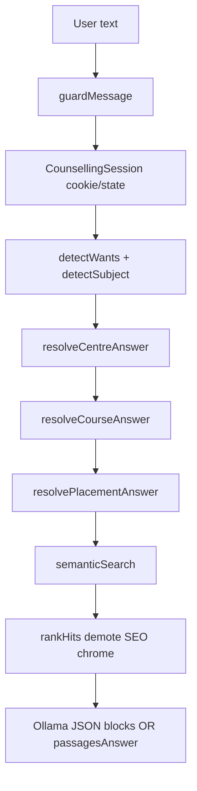
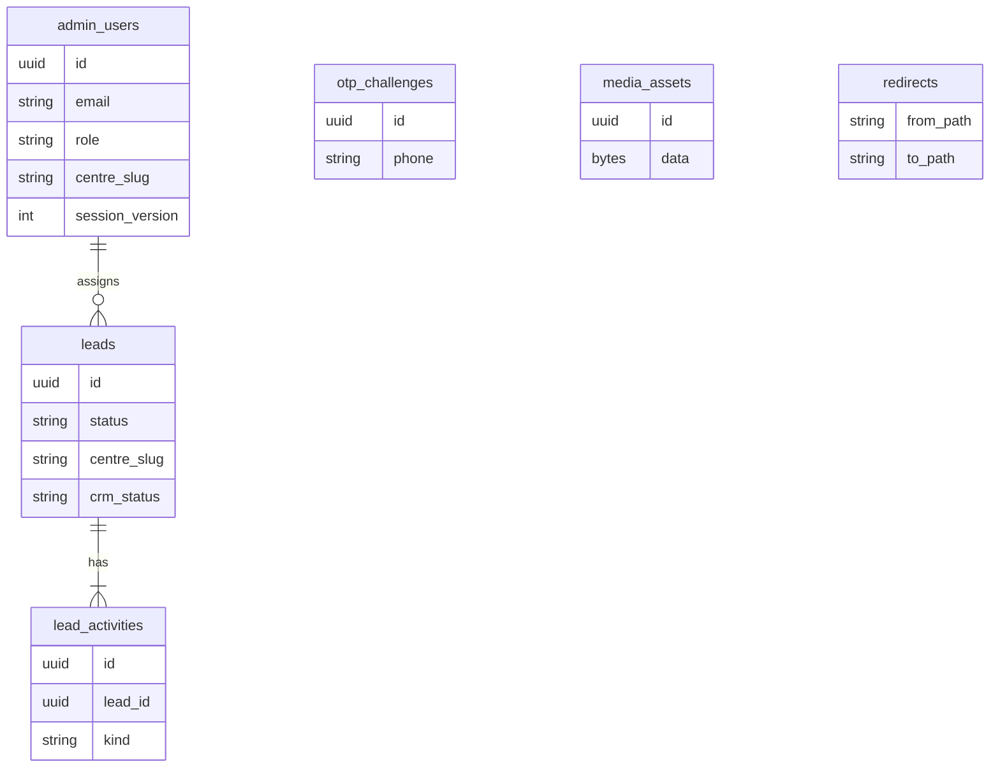
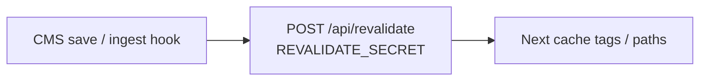

# Data flows — content, leads, chatbot

End-to-end pictures of how data moves through the Jetking platform.

---

## 1. Content truth diagram



**Invariant:** chatbot structured answers and marketing pages should agree because both call `content.listCourses()` / `getPlacementsPage()` / centre loaders.

---

## 2. CMS collection write path (detail)



---

## 3. Enquiry / lead intake

**Dual write:** every live path stores a row in `leads` (admin panel) first, then calls shared [`src/lib/leads/crm-handoff.ts`](../src/lib/leads/crm-handoff.ts) so the same lead is pushed to the external CRM when configured.



| Field group | Examples |
| --- | --- |
| Identity | name, phone, email |
| Intent | courseInterest, courseSlug, qualification |
| Location | city, state, centreSlug |
| Attribution | utm_*, landingPage, form, source |
| Ops | status, assignedTo, followUpAt, crmStatus (`none` / `routed` / `skipped` / `failed` / …) |

| Path | Admin `leads` | CRM hand-off |
| --- | --- | --- |
| `/api/enquiry` (all public forms + chatbot) | Yes | Yes via `handoffLeadToCrm` |
| `/api/journey/save` (soft save) | Yes | Yes when CRM can accept the payload |
| Admin → Add lead | Yes | Yes (same hand-off; centre staff scoped centre used when present) |
| Admin CSV Import | Yes | No — archival only, avoids flooding CRM |

Smartrain (`CRM_PROVIDER=smartrain`) requires email + a CRM-mapped centre; incomplete leads stay in admin with `crmStatus: skipped`.

---

## 4. Chatbot factual answer path



### What each resolver guarantees

| Resolver | Source of truth | Never does |
| --- | --- | --- |
| `resolveCentreAnswer` | Centres / cities CMS | Invent addresses |
| `resolveCourseAnswer` | `listCourses()` | Quote undisclosed fees; list competitor institutes |
| `resolvePlacementAnswer` | `getPlacementsPage()` | Promise job guarantees |
| `guardMessage` guarantee branch | Fixed honest copy | Echo “100% placement” SEO |

Embeddings file: `src/content/jetking-embeddings.json` (rebuild: `npm run build:chatbot-index`).

---

## 5. Auth cookie map

```mermaid
flowchart LR
  subgraph Cookies
    A[jk_admin_session]
    U[jk_user_session]
  end
  A --> Admin[/admin]
  U --> Account[/account + /chatbot]
```

Secrets are **separate** on purpose so rotating one surface does not invalidate the others. Visitor signup/login detail: **[AUTH.md](./AUTH.md)**.

---

## 6. Postgres tables (ops)



CMS collections may live as JSON documents in Postgres or the file store; the Drizzle schema in `src/lib/db/schema.ts` is authoritative for **ops** tables. Run `npm run db:migrate` after pull.

---

## 7. Revalidation



Without calling revalidate, ISR/static pages update on the next natural revalidation or redeploy — dynamic reads still see new CMS data when the store is queried per request.

---

## 8. Related

- [ARCHITECTURE.md](./ARCHITECTURE.md)
- [AUTH.md](./AUTH.md)
- [CHATBOT.md](./CHATBOT.md)
- [SHARED_DATABASE.md](./SHARED_DATABASE.md)
