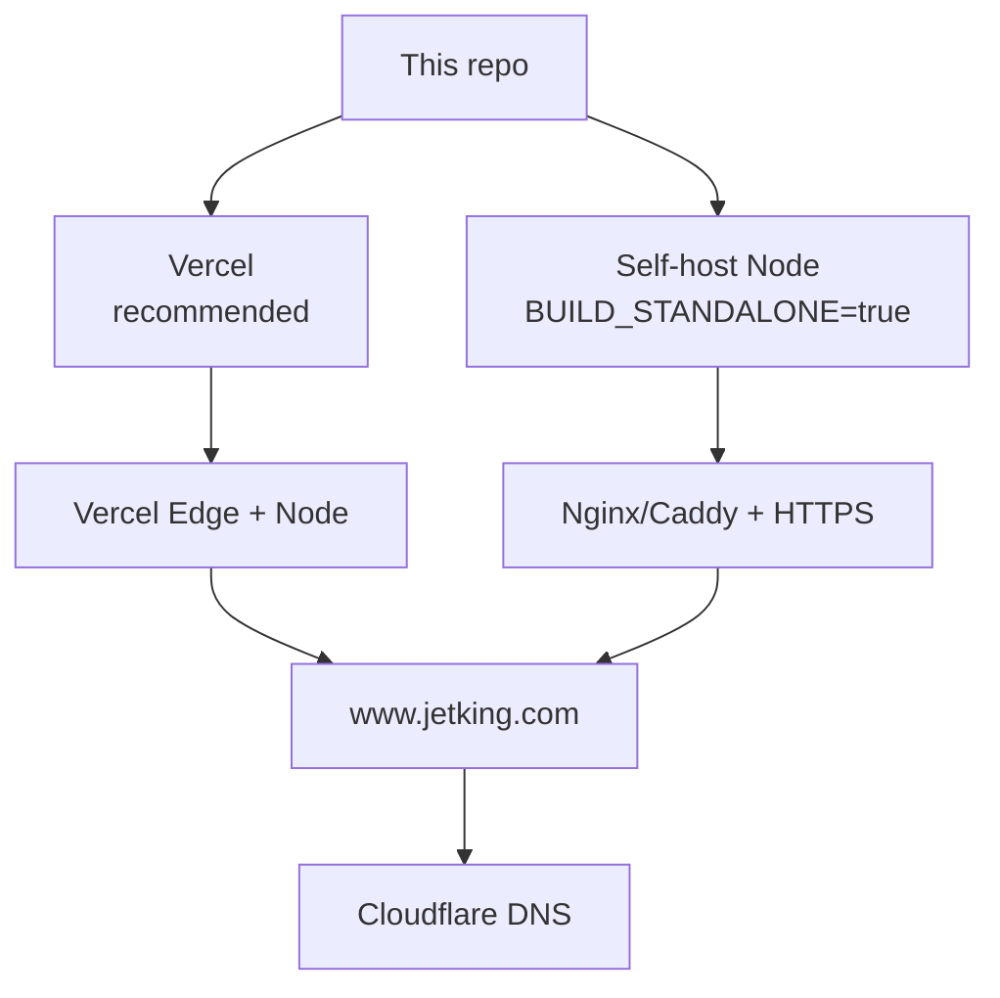
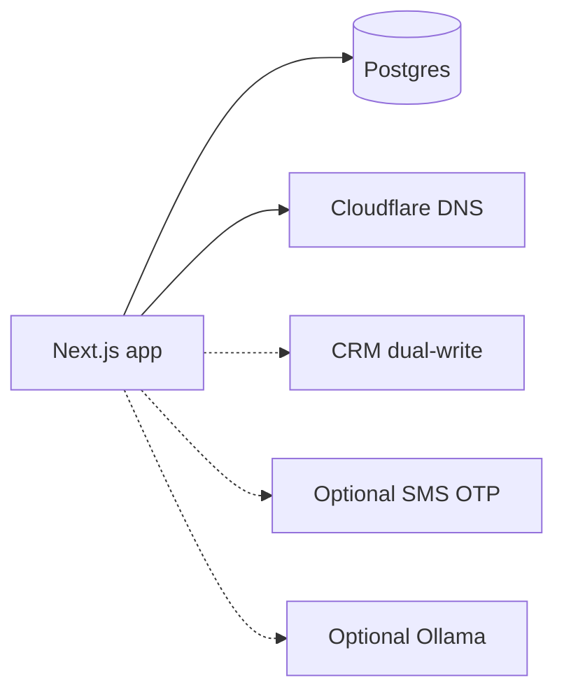
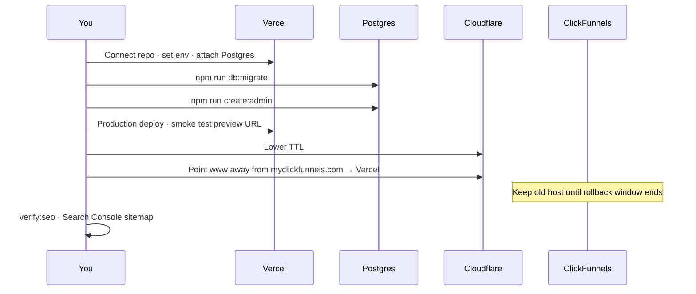

# Deployment runbook

How to take this Next.js platform live. Current **production DNS** for `www.jetking.com` still points at **ClickFunnels behind Cloudflare** — this app is separate until you cut DNS over.

---

## 1. Hosting options



| Option | When |
| --- | --- |
| **Vercel** | Default; `vercel.json` already present; project docs name `jetking-panel` |
| **Self-host** | No Vercel; set `BUILD_STANDALONE=true`, run `.next/standalone` behind a reverse proxy |

---

## 2. Required services



| Service | Required? | Purpose |
| --- | --- | --- |
| Postgres | **Yes for real prod** | Admin users, leads, CMS, OTP, media, redirects |
| Domain + TLS | Yes | Cloudflare → host |
| CRM webhook | Strongly recommended | Dual-write with admin Leads (`handoffLeadToCrm`) |
| SMTP mailbox | Recommended | Staff welcome / password emails, visitor reset link (`MAIL_*`) |
| Ollama | Optional | Freer chatbot phrasing; without it: structured + KB passages |
| OpenAI | **Not required** | Opt-in via `GUIDE_PROVIDER=openai\|auto` |

---

## 3. Environment checklist (production)

Generate secrets with `openssl rand -hex 32`. The complete, grouped list is in [ENVIRONMENT.md](./ENVIRONMENT.md); copy from [`.env.production.example`](../.env.production.example) (section 1 required, 2 recommended, 3 optional).

| Variable | Notes |
| --- | --- |
| `DATABASE_URL` | Postgres URL |
| `DATABASE_SSL` | `true` on managed PG |
| `NEXT_PUBLIC_SITE_URL` | `https://www.jetking.com` (canonicals) |
| `CONTENT_SOURCE` | `admin` |
| `NEXT_PUBLIC_SHOW_PLACEHOLDERS` | `false` |
| `NEXT_PUBLIC_ALLOW_INDEXING` | `true` only on real prod |
| `ADMIN_SESSION_SECRET` | Required |
| `USER_SESSION_SECRET` | Required if site accounts |
| `CHATBOT_SESSION_SECRET` | Required if chatbot accounts |
| `PERSONA_COOKIE_SECRET` | Not required for go-live (audience product disabled) |
| `REVALIDATE_SECRET` | For `/api/revalidate` |
| `CRM_ENDPOINT` / `CRM_API_KEY` | Lead dual-write to external CRM (with admin panel) |
| `CRM_PROVIDER` | `smartrain` when using Smartrain branch ids |
| `NEXT_PUBLIC_PHONE` / `NEXT_PUBLIC_WHATSAPP_NUMBER` | Real numbers |
| `GUIDE_PROVIDER` | `local` (default, no OpenAI) |
| `RATE_LIMIT_ALLOW_MEMORY` | `true` if single instance without Redis |
| `MAIL_DRIVER`, `MAIL_HOST`, `MAIL_PORT`, `MAIL_USERNAME`, `MAIL_PASSWORD`, `MAIL_FROM_NAME`, `MAIL_ENCRYPTION` | Email (use an App Password for Gmail); `MAIL_PASSWORD` is **Sensitive** |
| `NEXT_PUBLIC_EMAIL_RESET_ENABLED` | `true` to show "email me a reset link" to visitors |
| Tracking (`NEXT_PUBLIC_GTM_ID`, `NEXT_PUBLIC_GA_IDS`, `NEXT_PUBLIC_META_PIXEL_IDS`) | Defaults are the live site's tags; they load only when indexing is allowed. Do not set `NEXT_PUBLIC_ALLOW_INDEXING=false` on production. |

Copy from `.env.example` — never commit `.env.local`.

---

## 4. Vercel cutover steps



1. Create/attach Postgres (Vercel Storage / Neon).
2. Set Production env vars.
3. `npm run db:migrate` (applies every migration, including `0014_custom_roles`), `npm run seed:locations`, then `create:admin`, against the Production URL.
4. Deploy Production; test on `*.vercel.app` first.
5. In Cloudflare, change `www` from ClickFunnels CNAME to Vercel target.
6. Run `npm run verify:seo -- --base https://www.jetking.com`.
7. Submit sitemap; monitor Search Console 14 days.

**Rollback:** previous Vercel deployment (instant). Keep Cloudflare ready to point back to ClickFunnels if needed.

---

## 5. Self-host steps

```bash
npm ci
export BUILD_STANDALONE=true
npm run build
# Apply migrations with DATABASE_URL set
npm run db:migrate
npm run create:admin -- --name "..." --email "..." --password "..."
node .next/standalone/server.js   # or your process manager
```

Put Nginx/Caddy in front with HTTPS. Point Cloudflare A/AAAA or CNAME at the server.

Chatbot without OpenAI: leave `GUIDE_PROVIDER=local`. Optionally run Ollama on a reachable host and set `OLLAMA_BASE_URL`.

---

## 6. Post-deploy smoke test

| Check | Expect |
| --- | --- |
| `/` | Homepage renders, no “To be updated” if placeholders off |
| `/courses/[slug]` | Real course copy |
| `/centres/...` | Real address/phone |
| `/enquiry` | Lead appears in `/admin/leads` **and** is handed to CRM when configured |
| Admin → Add lead | Same dual write (panel + CRM) |
| `/admin/login` | New admin can sign in |
| Admin → Team & access → add a member | Welcome email arrives (or the page says email is not set up) |
| Site → Login → Forgot password → email | Reset link arrives, works once, then is rejected |
| Page source / Tag Assistant | GTM, GA4, Google Ads and Meta pixel load on the production domain, and **not** on previews |
| `/chatbot` | Course/fees/placement answers from catalogue (no OpenAI) |
| `/robots.txt` / `/sitemap.xml` | Correct host |

---

## 7. Content & chatbot after go-live

After major CMS changes:

```bash
npm run build:chatbot-index
npm run eval:chatbot-retrieval   # optional quality gate
```

Structured course/placement answers do **not** require a rebuild — they read CMS live.

---

## 8. Related

- [INDEX.md](./INDEX.md)
- [SHARED_DATABASE.md](./SHARED_DATABASE.md)
- [ARCHITECTURE.md](./ARCHITECTURE.md)
- [HANDOVER.md](./HANDOVER.md) — older cutover notes (prefer this runbook)
