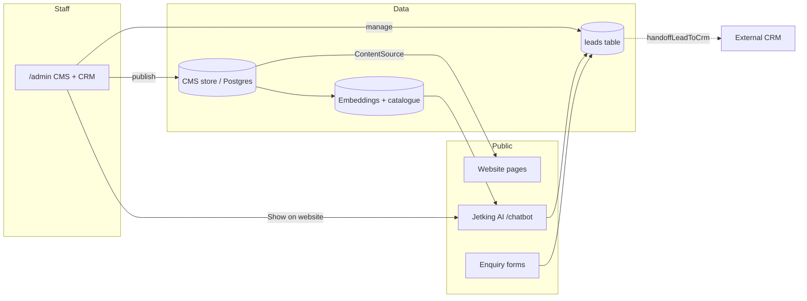

# Jetking platform documentation

One Next.js application serves the **public website**, the **staff admin CMS/CRM** (`/admin`), and the **Jetking AI chatbot** (`/chatbot`).

### For Jetking stakeholders (non-technical)

→ **[CLIENT_GUIDE.md](./CLIENT_GUIDE.md)** — plain-language explanation of the website, admin, chatbot, leads, login, and go-live checklist.  
→ **[BRAND_GUIDELINES.md](./BRAND_GUIDELINES.md)** — colour palette, fonts, logo rules, and how to apply them on print, social, and decks.  
(One site for everyone — no separate student/parent/professional paths.)

### For product / engineering

| Document | What it covers |
| --- | --- |
| [ARCHITECTURE.md](./ARCHITECTURE.md) | System overview, stack, request paths, security — with diagrams |
| [PUBLIC_WEBSITE.md](./PUBLIC_WEBSITE.md) | Public pages, content pipeline, SEO |
| [ADMIN_CMS.md](./ADMIN_CMS.md) | Admin panel: roles, modules, edit → publish → live site |
| [AUTH.md](./AUTH.md) | Visitor signup/login (site + chatbot) and staff `/admin` login |
| [DATA_FLOWS.md](./DATA_FLOWS.md) | Content store, lead dual-write (panel + CRM), chatbot, enquiry |
| [DEPLOYMENT_RUNBOOK.md](./DEPLOYMENT_RUNBOOK.md) | Go-live (Vercel or self-host), env vars, DNS cutover |
| [ENVIRONMENT.md](./ENVIRONMENT.md) | Every environment variable, grouped: required / recommended / optional |
| [CHATBOT.md](./CHATBOT.md) | Jetking AI retrieval, CMS show/hide, Ollama, index rebuild |
| [ADMIN_PANEL.md](./ADMIN_PANEL.md) | Admin UI details, design system, collection notes |
| [SHARED_DATABASE.md](./SHARED_DATABASE.md) | Postgres setup for teams |
| [ASSETS.md](./ASSETS.md) | Image / media conventions |

### Quick mental model

**Rule of thumb:** editors change content in `/admin` → published records flow through `ContentSource` → public pages and chatbot structured answers read the same truth. Jetking AI can be shown or hidden for the whole site from **Assistant settings → Show on website**. Leads always land in Postgres (admin Leads board) when `DATABASE_URL` is set, and are also handed to the external CRM when `CRM_ENDPOINT` is configured.
