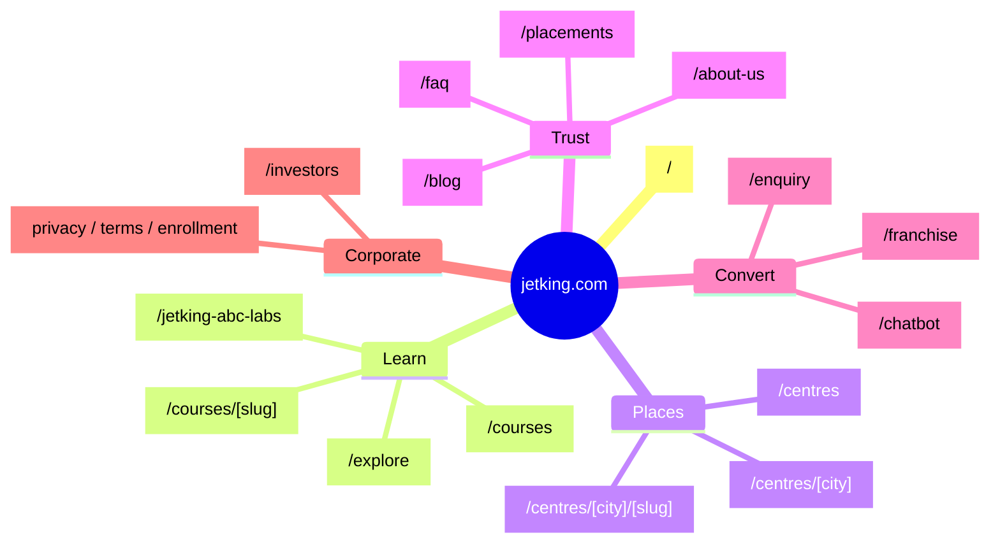
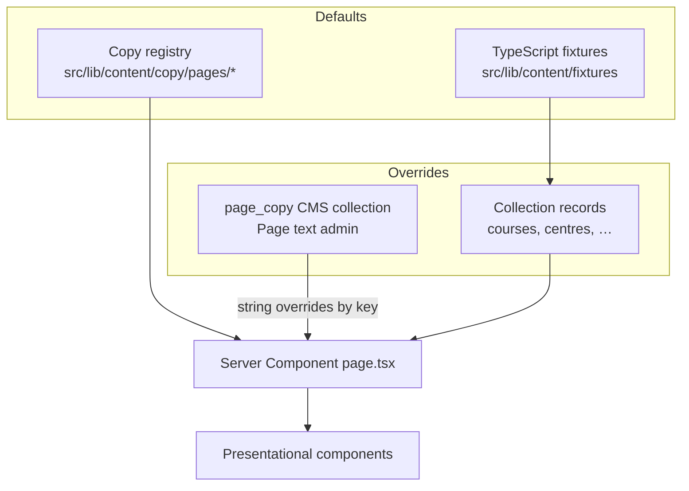
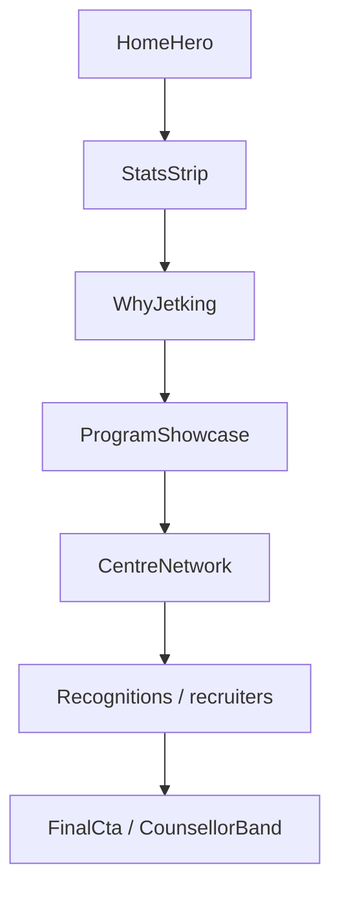
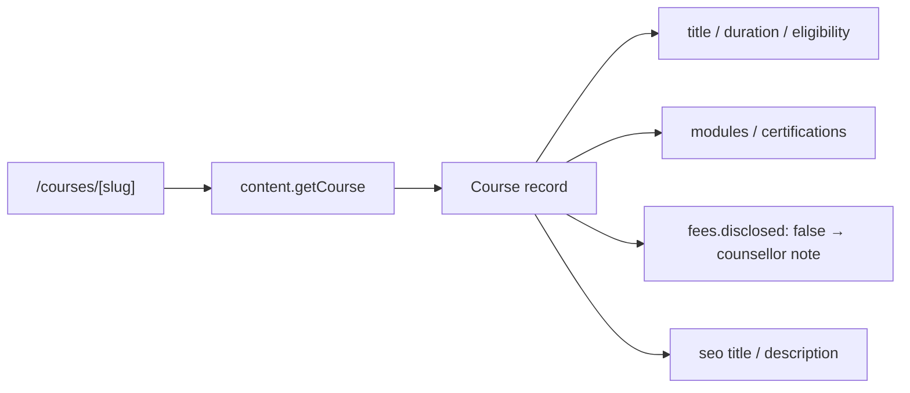
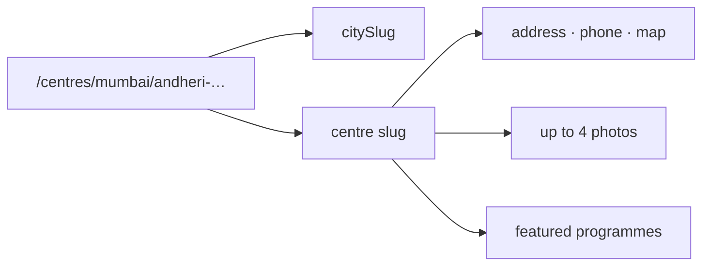
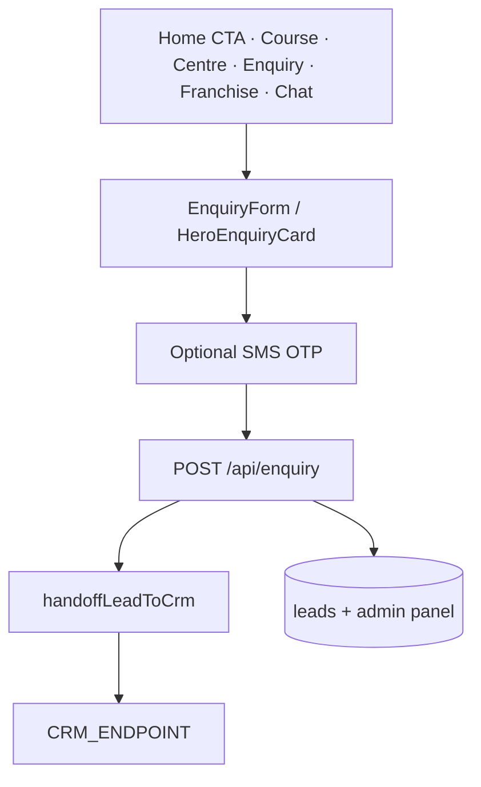
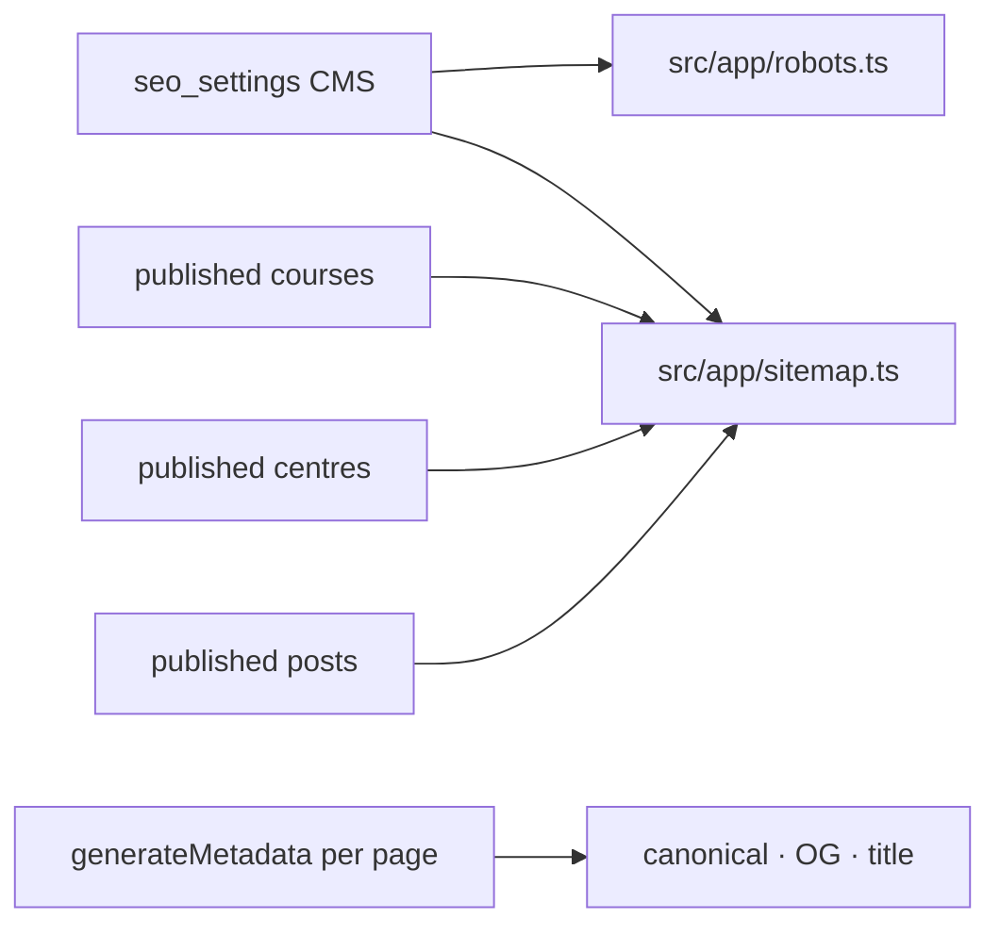

# Public website — how it works

## 1. Purpose

The public site markets Jetking programmes (cloud, cyber, networking, degrees, certifications), shows centres across India, captures enquiries, and links into Jetking AI. Pages render one canonical HTML document for SEO (no cloaking).

---

## 2. Information architecture

**Removed from the live site:** “For students / parents / professionals” paths. `/student`, `/parent`, and `/professional` **permanently redirect to `/`**. The HTML sitemap no longer lists a “Choose your path” audience group. Course and blog pages use one generic next-step nudge (no audience variants).

### Primary routes

| Path | Role | Main CMS inputs |
| --- | --- | --- |
| `/` | Homepage hero + programme showcase + centres + CTAs | `page_copy`, courses, centres, logos, placements stats, announcements |
| `/courses` | Catalogue explorer (+ flexible-learning band) | courses, page_copy (incl. shared flex.* keys) |
| `/courses/[slug]` | Programme detail | course record + page_copy |
| `/centres` | Directory | centres, cities, page_copy |
| `/centres/[city]` | City hub | city + centres |
| `/centres/[city]/[slug]` | Centre detail | centre |
| `/placements` | Placement story + partners | `placements_page` |
| `/about-us` | Company / leadership (+ families band) | `about_page`, page_copy |
| `/blog`, `/blog/[slug]` | Articles | posts |
| `/enquiry` | Lead form | courses, centres, cities |
| `/chatbot` | Jetking AI (only when Assistant settings → Show on website is on; otherwise 404) | `chatbot_settings`, knowledge |
| `/franchise` | Franchise pitch | page_copy, FAQs, testimonials |
| `/explore` | Optional extra landing (often noindex) | page_copy, logos |
| `/sitemap` | HTML sitemap | page_copy (`Learn more` links — not audience paths) |
| `/investors` | Disclosures | `investors_page` |
| Legal URLs | Policies | `legal_documents` |

The authoritative map of “which CMS collection appears on which page” lives in code: `src/app/(admin)/admin/registry.ts` (`SITE_MAP` / `appearsOn`). Admin → **Website** page renders that map for editors.

---

## 3. How a page gets its copy

1. **Structural content** (course modules, centre address) → collection editors.
2. **Marketing chrome** (H1, button labels, section titles) → **Page text** (`page_copy`) keyed strings.
3. **Fixtures** seed both when CMS is empty so local `npm run dev` always renders.

---

## 4. Homepage composition

Implementation: `src/app/page.tsx` + `src/components/home/**`. Design tokens and motion follow `design-system/MASTER.md` and `src/styles/kit.css`.

---

## 5. Course & centre pages

### Course page data

Fees on the live site are **not published as a single figure**. Chatbot and UI must say fees vary / counsellor confirms — never invent ₹ amounts.

### Centre page data

Empty gallery slots fall back to Page text → Centres imagery (documented on the Centres admin note).

---

## 6. No audience / persona product (go-live)

The public website is a **single experience for everyone** — not three “student / parent / professional” sites.

| Item | Status |
| --- | --- |
| `/student`, `/parent`, `/professional` | **301 → `/`** |
| Sitemap “Choose your path” | **Removed** (replaced with Courses / Centres / Explore / Chatbot) |
| Persona adaptive nudges & list reordering | **Disabled** on courses & blog |
| Admin Persona rules | **Hidden** |
| `NEXT_PUBLIC_PERSONA_MODE` | Leave **unset** (default = normal site) |

Shared copy that used to live under those landings is edited in Page text as **About — families band** and **Courses — flexible learning** (not as audience landings).

---

## 7. Login & signup (visitors)

Public visitors use a **shared account** for the website and `/chatbot` when Jetking AI is shown (header → Login / Sign up, or `/account`). Forgotten passwords are reset by an emailed single-use link and/or an SMS code (see [AUTH.md](./AUTH.md)).

**Jetking AI visibility** is CMS-only: **Admin → Assistant settings → Show on website**. Page text still holds Ask Jetking AI *wording*; that switch controls whether links and `/chatbot` exist for visitors (see [CHATBOT.md](./CHATBOT.md)).

**Header and tracking.** The header menu is editable in the admin (**Header menu**); the first four links show in the desktop bar and the courses link opens the mega menu. Analytics and ad tags (GTM, GA4, Google Ads, Meta pixels) are added by `src/components/TrackingScripts.tsx` from `src/lib/tracking.ts`, only on the indexable production site.

Full detail (signup fields, email vs OTP login, reset, cookies, secrets): **[AUTH.md](./AUTH.md)**.

Staff login is separate → `/admin/login` (same doc, §3).

---

## 8. Enquiry & conversion surfaces

Every enquiry is stored in the **admin Leads board** and handed to the **CRM** via shared `handoffLeadToCrm` (when `CRM_ENDPOINT` is set). Panel first — CRM outages do not lose leads.

OTP: enable with `OTP_ENABLED` + `NEXT_PUBLIC_OTP_ENABLED` and SMS credentials (same stack as visitor mobile login / forgot password). Requires shared DB in production for rate limits.

---

## 9. SEO, sitemap, robots

| Control | Purpose |
| --- | --- |
| `NEXT_PUBLIC_SITE_URL` | Canonical origin (use this in prod, not only `SITE_URL`) |
| `NEXT_PUBLIC_ALLOW_INDEXING` | Kill-switch for staging |
| Admin → SEO settings | Sitemap inclusions, robots policy |
| Admin → Redirects | Runtime 301s without redeploy |

Legacy URL inventory and gaps: [SEO_ROUTING_AUDIT.md](./SEO_ROUTING_AUDIT.md).

---

## 10. Design system notes

- Brand red (`jk-*` tokens), Bricolage Grotesque / Plus Jakarta Sans.
- Kit primitives: `src/components/kit`, `src/styles/kit.css`.
- Prefer full-bleed heroes and existing patterns when editing marketing pages (see project design rules).

---

## 11. Related

- [ARCHITECTURE.md](./ARCHITECTURE.md)
- [AUTH.md](./AUTH.md) — signup / login / OTP
- [ADMIN_CMS.md](./ADMIN_CMS.md) — who edits what
- [CHATBOT.md](./CHATBOT.md) — Jetking AI show/hide and answer path
- [DATA_FLOWS.md](./DATA_FLOWS.md)
